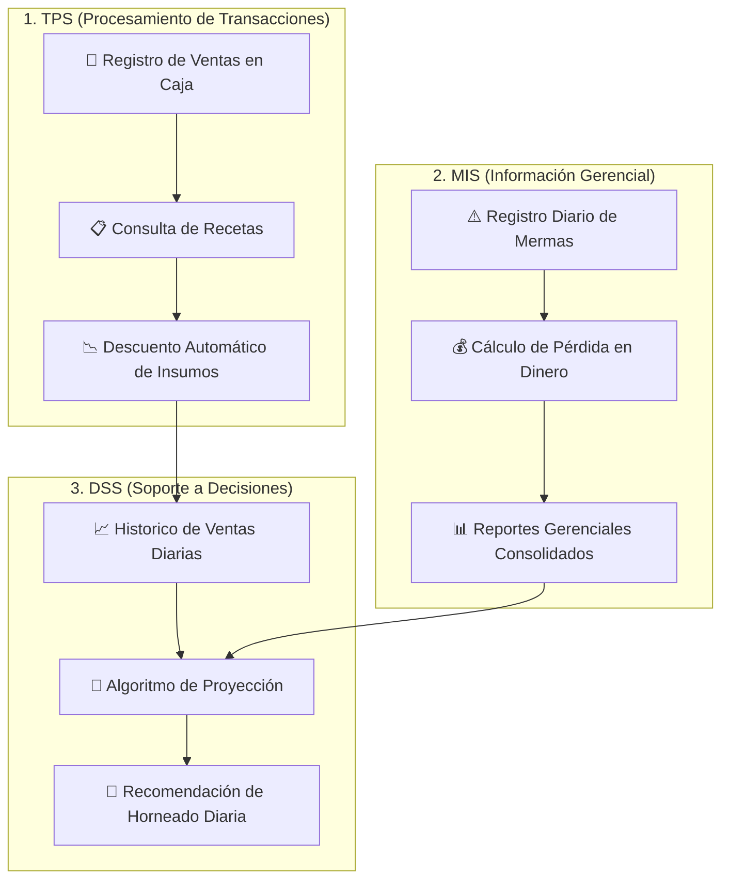

<div align="center">

# 🍞 PamPam — Sistema ERP para Panaderías

[](https://www.python.org/)
[](https://www.sqlite.org/)
[](#)
[](#)

*Sistema Integral de Gestión de Inventario, Control de Procesos Operativos y Soporte a Decisiones para Redes de Panadería.*

[Descripción](#-acerca-del-sistema) • [Arquitectura](#-arquitectura-del-sistema) • [Características](#-características-principales) • [Instalación](#-instalación-y-uso) • [Autores](#-equipo-de-desarrollo)

---

</div>

## 📌 Acerca del Sistema

**PamPam** es un sistema ERP liviano diseñado específicamente para cubrir las necesidades operativas y estratégicas de **Bakehouse y Co.** 

Conecta directamente el terminal de punto de venta (POS) en caja con la administración corporativa en oficina, permitiendo automatizar el control de materias primas en tiempo real, calcular pérdidas financieras por desperdicio y predecir el volumen óptimo de horneado diario.

> [!NOTE]
> **¿Por qué es un ERP?**  
> PamPam integra en una sola base de datos centralizada múltiples áreas de la empresa (Ventas, Inventario, Costos y Producción). La información generada en una transacción actualiza en tiempo real los inventarios de insumos y retroalimenta los modelos de predicción de producción.

---

## 🏗️ Arquitectura del Sistema

El sistema implementa una arquitectura basada en **3 Niveles de Información de Negocio**:



---

## ✨ Características Principales

### 🛒 1. Control Transaccional de Ventas e Inventario (TPS)
- **Registro en Caja:** Interfaz ágil para la captura de ventas diarias.
- **Descuento por Receta:** Deducción automática e inmediata de insumos (*harina, azúcar, huevos, mantequilla*) según las formulaciones de cada producto.
- **Prevención de Quiebres:** Mantiene el control continuo para evitar desabastecimiento de materias primas a mitad de jornada.

### 📊 2. Reporte de Mermas y Costos Operativos (MIS)
- **Control de Desperdicios:** Registro de productos no vendidos al cierre del turno.
- **Valorización Monetaria:** Conversión automática de productos desechados a costo real de ingredientes para evaluación administrativa.

### 🤖 3. Planificación Predictiva de Producción (DSS)
- **Sugerencia de Horneado:** Motor de recomendación para la producción del día siguiente basado en tendencias históricas.
- **Reducción de Pérdidas:** Disminución proactiva de la sobreproducción y optimización del rendimiento de materias primas.

---

## 📁 Estructura del Repositorio

```bash
PamPam/
├── 📄 README.md                    # Documentación principal del repositorio
├── 🐍 pampam_app.py                # Script principal (UI + Lógica TPS/MIS/DSS)
├── 👥 usuarios.py                  # Módulo de autenticación, roles y seguridad
├── 🧪 test_login.py                # Suite de pruebas automatizadas para autenticación
├── 🗄️ pampam.db                    # Base de datos relacional (SQLite)
└── 💾 pampam_respaldo_20261101.db  # Backup histórico de producción
```

---

## 💻 Requisitos Técnicos

| Componente | Especificación Mínima | Recomendada |
| :--- | :--- | :--- |
| **Runtime** | Python 3.10+ | Python 3.14 |
| **Base de Datos** | SQLite 3 | SQLite 3 (Nativa de Python) |
| **GUI Framework** | Tkinter / GUI estándar | Tkinter |
| **OS** | Windows 10+ / macOS / Linux | Windows 11 / Linux |

---

## 🚀 Instalación y Uso

### 1. Clonar el repositorio

```bash
git clone (https://github.com/AlexanderC25/ERP-academico.git)
cd PamPam
```

### 2. Ejecutar la Aplicación

No se requieren dependencias externas complejas. Simplemente ejecuta el punto de entrada con Python:

```bash
python pampam_app.py
```

### 3. Ejecutar Pruebas Automatizadas

Para validar las funciones de control de acceso y autenticación de usuarios:

```bash
python test_login.py
```

---

## 🛡️ Seguridad y Buenas Prácticas

> [!WARNING]
> Asegúrate de **no incluir** el archivo `pampam.db` en tus commits de producción si contiene credenciales de prueba o datos reales no cifrados. Se recomienda incluir los archivos `.db` en tu `.gitignore` personal.

---

## 👨‍💻 Equipo de Desarrollo

| Contribuidor |
| :--- |
| **David Hernández** |
| **Sebastián Boada** |
| **Nicolas Centeno** |
---

<div align="center">
  <sub>Desarrollado para <b>Bakehouse y Co.</b> — 2026</sub>
</div>
